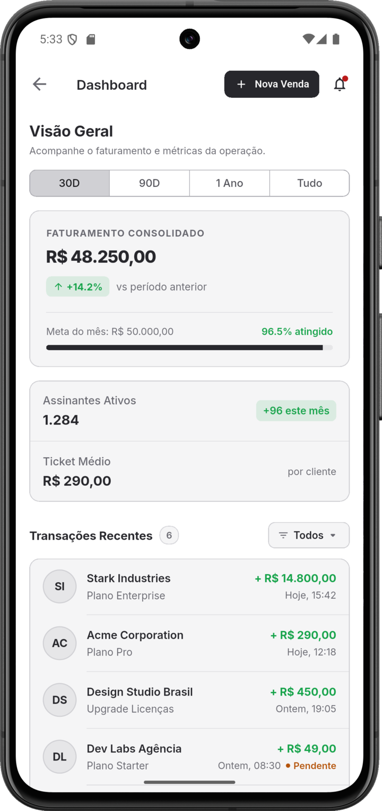
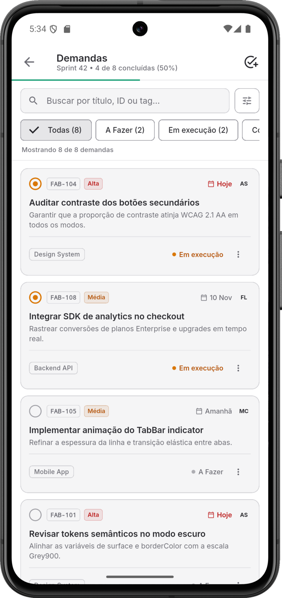
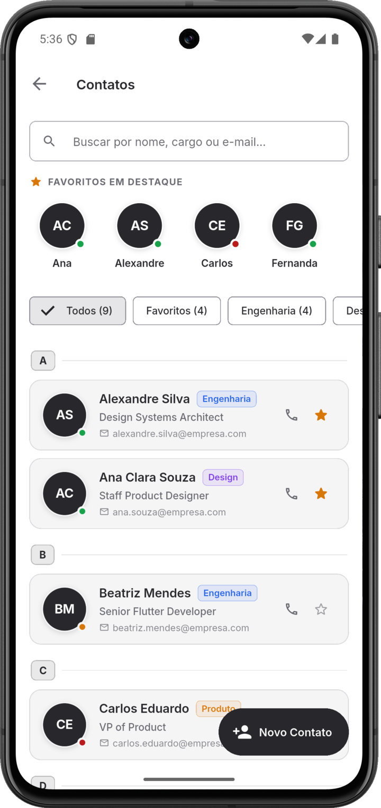
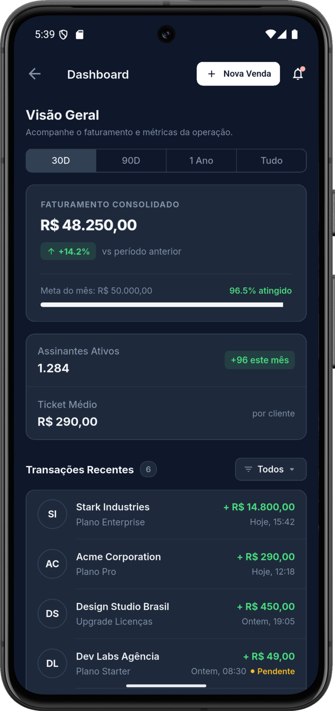
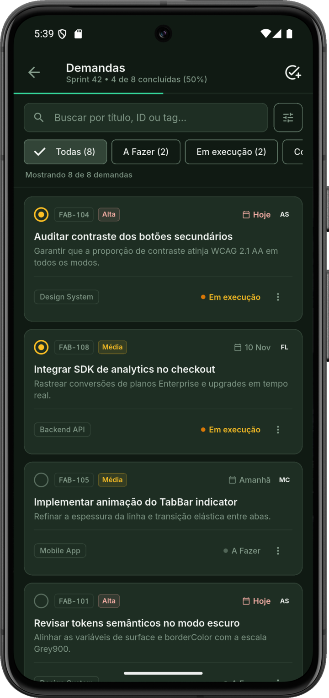
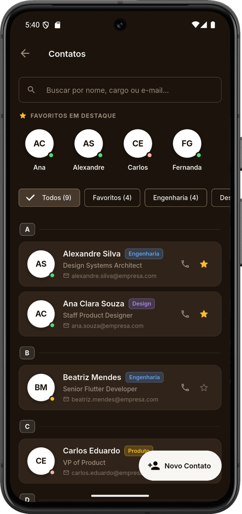

# Fabric

> A modern, minimal, and pure Material 3 Theme Layer for Flutter. Zero custom widgets — 100% native Flutter widgets themed out-of-the-box.

[](https://github.com/carllosnc/fabric/actions/workflows/ci.yml)


---

## 🎯 Architecture & Philosophy: Pure Theme Layer

**Fabric is strictly a Theme Layer — NOT a custom component library.**

Most UI kits introduce custom widget wrappers (such as `CustomButton`, `MyCard`, `AppTextField`). This introduces vendor lock-in, forces your team to learn proprietary widget APIs, and makes future migrations painful.

Fabric takes the opposite approach: **Zero custom widgets.**

Whenever Flutter exposes a `*ThemeData` (e.g. `CardThemeData`, `InputDecorationTheme`, `ElevatedButtonThemeData`, `DataTableThemeData`, `SearchBarThemeData`, `NavigationDrawerThemeData`), Fabric styles it directly at the root `ThemeData` level.

```
┌────────────────────────────────────────────────────────┐
│                   Your Application                     │
│  Card, ElevatedButton, TextField, NavigationRail, etc. │
└───────────────────────────┬────────────────────────────┘
                            │ (100% standard Flutter widgets)
                            ▼
┌────────────────────────────────────────────────────────┐
│                  Fabric Theme Layer                    │
│      ThemeData + ColorScheme + Material 3 Styles       │
└────────────────────────────────────────────────────────┘
```

### Why a Theme Layer instead of Custom Components?

| Feature | Custom Component Kits | Fabric Theme Layer |
| :--- | :--- | :--- |
| **Widget APIs** | Proprietary wrappers (`AppCard`, `AppButton`) | **100% canonical Flutter widgets** (`Card`, `FilledButton`) |
| **Vendor Lock-in** | High — difficult to replace or decouple | **Zero** — remove or swap Fabric with zero widget changes |
| **Learning Curve** | High — developers must learn proprietary APIs | **Zero** — standard Flutter documentation applies |
| **Ecosystem Compatibility** | Struggles with 3rd-party packages | **Seamless** — any package honoring `ThemeData` is styled |
| **Flutter SDK Upgrades** | Breaking changes on internal wrapper code | **Future-proof** — leverages official Flutter Material 3 specs |

---

## ✨ Features

- 🎨 **Pure Theme Layer**: Zero custom UI wrappers. Use canonical Flutter widgets with a unified, contemporary Material 3 aesthetic.
- ⚡ **46+ Standard Flutter Widgets Styled**: Complete out-of-the-box styling for buttons, inputs, dialogs, drawers, navigation rails, pickers, tables, and more.
- 🌓 **First-Class Dark & Light Modes**: High-contrast, accessibility-tested color palettes and surface container roles (`surfaceDim`, `surfaceBright`, `surfaceContainerLowest`..`surfaceContainerHighest`).
- 🎛️ **8 Hand-Crafted Color Swatches**: Neutral grays (`fabricGrey`), oceanic blues, teals, emerald greens, and more, each featuring 11 shade stops (`50` to `950`).
- 🧩 **Design Tokens via `ThemeExtension`**: Direct access to semantic colors (`success`, `warning`, `info`), border tokens, elevated surfaces, and muted foregrounds via `context.fabricTokens`.
- ✍️ **Tailored Typography**: Tuned for `Inter` with progressive negative letter-spacing and optical line heights; fully compatible with `google_fonts`.

---

## 📦 Installation

Add Fabric to your `pubspec.yaml`:

```yaml
dependencies:
  fabric:
    git:
      url: https://github.com/carllosnc/fabric.git
```

*(Or from pub.dev once published):*

```yaml
dependencies:
  fabric: ^0.0.7
```

---

## 🚀 Quick Start

### 1. Apply to `MaterialApp`

Configure `FabricTheme` once in your `MaterialApp`. That's it — all Flutter widgets in your app now inherit Fabric's design system:

```dart
import 'package:fabric/fabric.dart';
import 'package:flutter/material.dart';

void main() {
  runApp(const MyApp());
}

class MyApp extends StatelessWidget {
  const MyApp({super.key});

  @override
  Widget build(BuildContext context) {
    // Declarative configuration
    const fabricTheme = FabricTheme(
      color: fabricGrey,       // Pick any swatch (fabricGrey, fabricBlue, etc.)
      fontFamily: 'Inter',     // Optional font family
    );

    return MaterialApp(
      title: 'Fabric App',
      theme: fabricTheme.lightTheme,
      darkTheme: fabricTheme.darkTheme,
      themeMode: ThemeMode.system,
      home: const MyHomePage(),
    );
  }
}
```

Or use the direct static helpers:

```dart
MaterialApp(
  theme: FabricTheme.light(color: fabricBlue, fontFamily: 'Inter'),
  darkTheme: FabricTheme.dark(color: fabricBlue, fontFamily: 'Inter'),
  home: const MyHomePage(),
);
```

### 2. Using Custom Fonts or `google_fonts`

Fabric accepts any custom `TextTheme`. For example, using Google Fonts:

```dart
import 'package:google_fonts/google_fonts.dart';

final fabricTheme = FabricTheme(
  color: fabricGrey,
  textTheme: GoogleFonts.interTextTheme(),
);
```

---

## 🔨 How to Build Screens (Pure Flutter)

Because Fabric styles native Flutter widgets through `ThemeData`, you don't import any custom button or card widgets. You simply write standard Flutter:

```dart
import 'package:flutter/material.dart';

class UserCard extends StatelessWidget {
  const UserCard({super.key});

  @override
  Widget build(BuildContext context) {
    // Standard Flutter Card & Widgets — styled automatically by Fabric!
    return Card(
      child: Padding(
        padding: const EdgeInsets.all(20),
        child: Column(
          crossAxisAlignment: CrossAxisAlignment.start,
          children: [
            const TextField(
              decoration: InputDecoration(
                labelText: 'Username',
                hintText: 'Enter your handle',
                prefixIcon: Icon(Icons.alternate_email),
              ),
            ),
            const SizedBox(height: 16),
            Row(
              mainAxisAlignment: MainAxisAlignment.end,
              children: [
                OutlinedButton(
                  onPressed: () {},
                  child: const Text('Cancel'),
                ),
                const SizedBox(width: 8),
                FilledButton(
                  onPressed: () {},
                  child: const Text('Save Changes'),
                ),
              ],
            ),
          ],
        ),
      ),
    );
  }
}
```

---

## 🎨 Design Tokens & Active Swatch

When building custom layouts or container decorations, access Fabric's design tokens directly through `BuildContext`:

```dart
final tokens = context.fabricTokens;
final swatch = context.fabricSwatch;

Container(
  decoration: BoxDecoration(
    color: tokens.surfaceElevated,              // Dynamic elevated surface (shade50 light / shade800 dark)
    border: Border.all(color: tokens.borderColor), // Crisp 1px border (shade200 light / shade700 dark)
    borderRadius: BorderRadius.circular(8),
  ),
  child: Text(
    'Status: Operational',
    style: TextStyle(color: tokens.successColor), // Semantic green (#16A34A / #4ADE80)
  ),
);
```

### Available Tokens on `context.fabricTokens`:

| Token | Description | Light Value | Dark Value |
| :--- | :--- | :--- | :--- |
| `borderColor` | Subtle 1px perimeter border for cards, inputs, containers | `swatch.shade200` | `swatch.shade700` |
| `surfaceElevated` | Elevated surface for cards, dropdowns, searchbars | `swatch.shade50` | `swatch.shade800` |
| `mutedForeground` | Secondary / placeholder text and muted icons | `swatch.shade500` | `swatch.shade400` |
| `successColor` | Positive semantic state (success, active, completed) | `#16A34A` | `#4ADE80` |
| `warningColor` | Cautionary semantic state (warning, pending, alert) | `#D97706` | `#FBBF24` |
| `infoColor` | Informational semantic state (info, in-progress) | `#2563EB` | `#60A5FA` |

---

## 🏛️ 46+ Native Flutter Widgets Themed by Fabric

Fabric configures all standard Material 3 widget themes out of the box:

| Category | Styled Native Flutter Widgets |
| :--- | :--- |
| **Buttons & Actions** | `ElevatedButton`, `FilledButton`, `FilledButton.tonal`, `OutlinedButton`, `TextButton`, `IconButton`, `FloatingActionButton`, `SegmentedButton`, `ToggleButtons` |
| **Inputs & Forms** | `TextField`, `TextFormField`, `InputDecoration`, `DropdownMenu`, `SearchBar`, `SearchAnchor`, `SearchView`, `Checkbox`, `Radio`, `Switch`, `Slider`, `RangeSlider` |
| **Surfaces & Containers** | `Card`, `BottomSheet`, `ExpansionTile`, `ListTile`, `DataTable`, `PaginatedDataTable`, `Divider`, `CarouselView` |
| **Navigation** | `AppBar`, `SliverAppBar`, `NavigationBar`, `BottomNavigationBar`, `NavigationRail`, `Drawer`, `NavigationDrawer`, `MenuBar`, `MenuAnchor`, `TabBar`, `BottomAppBar` |
| **Feedback & Overlays** | `AlertDialog`, `Dialog`, `SnackBar`, `LinearProgressIndicator`, `CircularProgressIndicator`, `Tooltip`, `DatePicker`, `TimePicker`, `MaterialBanner`, `Badge` |
| **Typography** | Full Material 3 `TextTheme` tuned with optical letter-spacing and proportional line heights |

---

## 🌈 Color Swatches

Fabric includes 8 hand-tuned, balanced palettes with 11 shade stops (`50` to `950`):

- `fabricGrey` *(Default refined charcoal)*
- `fabricBlue`
- `fabricRed`
- `fabricGreen`
- `fabricPurple`
- `fabricTeal`
- `fabricOrange`
- `fabricPink`

### Creating a Custom Swatch

Need your own brand colors? Define a custom `FabricSwatch`:

```dart
const FabricSwatch customBrand = FabricSwatch(
  0xFF0F172A,
  <int, Color>{
    50: Color(0xFFF8FAFC),
    100: Color(0xFFF1F5F9),
    200: Color(0xFFE2E8F0),
    300: Color(0xFFCBD5E1),
    400: Color(0xFF94A3B8),
    500: Color(0xFF64748B),
    600: Color(0xFF475569),
    700: Color(0xFF334155),
    800: Color(0xFF1E293B),
    900: Color(0xFF0F172A),
    950: Color(0xFF020617),
  },
);

// Apply custom brand swatch
final theme = FabricTheme(color: customBrand);
```

---

## 📸 Showcase & Example App

All screens below are built entirely with **standard Flutter native widgets** (`Card`, `SearchBar`, `SegmentedButton`, `FilledButton`, `Checkbox`, `FloatingActionButton`, etc.) styled automatically through `FabricTheme`:

### Light Mode

| Dashboard (`fabricGrey`) | Tasks & Sprints (`fabricGrey`) | Contacts Directory (`fabricGrey`) |
| :---: | :---: | :---: |
|  |  |  |

### Dark Mode

| Dashboard (`fabricGrey`) | Tasks & Sprints (`fabricGreen`) | Contacts Directory (`fabricOrange`) |
| :---: | :---: | :---: |
|  |  |  |

### Running the Example App

Explore interactive showcase pages (Dashboard, Tasks, Checkout, Contacts, Notifications, Settings, Navigation Rail) and test swatch & theme switching in real time:

```bash
cd example
flutter run
```

---

## ❓ FAQ

#### Do I need to import or learn any custom widgets?
**No.** Fabric does not provide custom widget wrappers. You write 100% native Flutter widgets (`Card`, `TextField`, `ElevatedButton`, `Switch`, etc.), and Fabric's theme layer applies the styles automatically.

#### Can I override specific styles for a single widget?
**Yes.** Because everything is standard Flutter, you can override properties directly on any widget (`Card(color: Colors.amber, ...)`) or use `.copyWith(...)` on `ThemeData` to adjust themes as needed.

#### Does Fabric support `google_fonts`?
**Yes.** Pass your custom `TextTheme` via `FabricTheme(textTheme: GoogleFonts.interTextTheme())`.

---

## 📄 License

MIT © [Carlos Costa](https://github.com/carllosnc)
