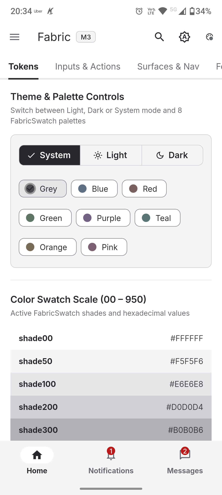
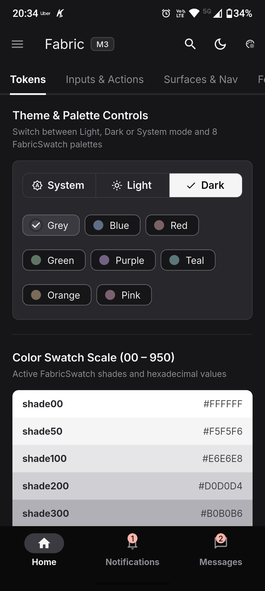
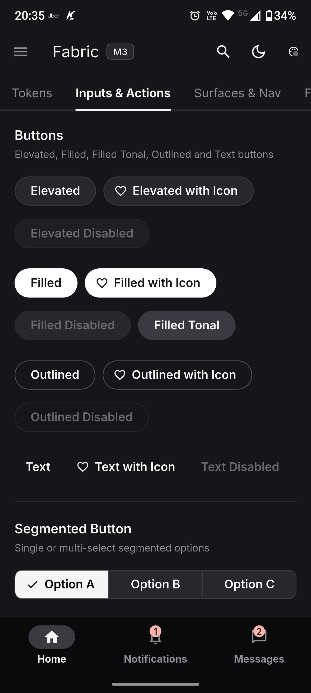
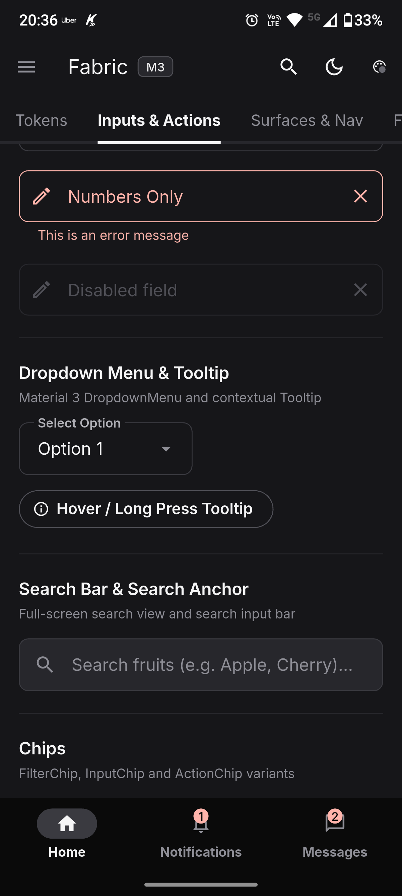
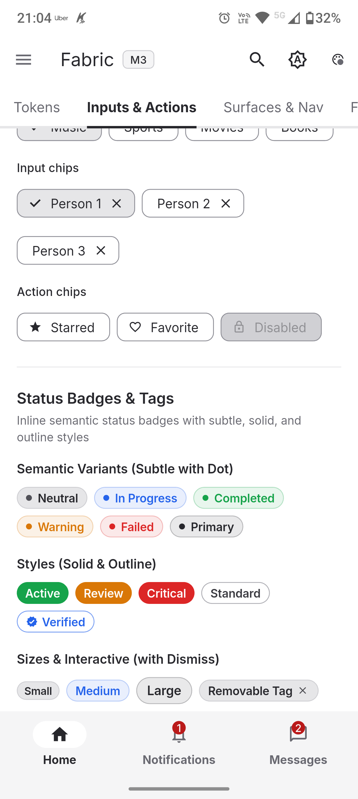
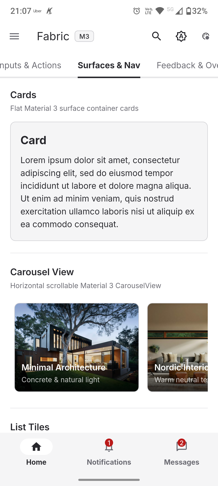
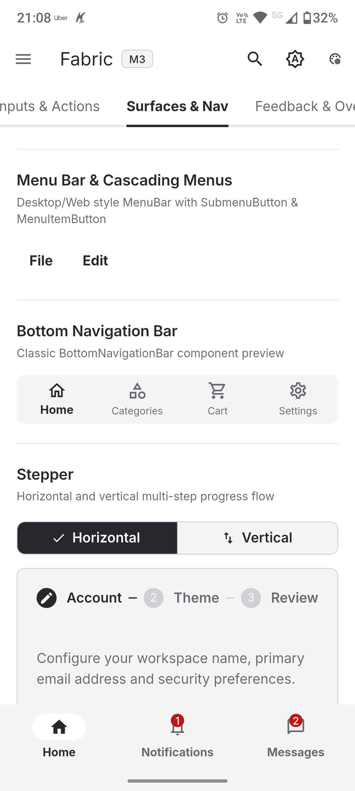
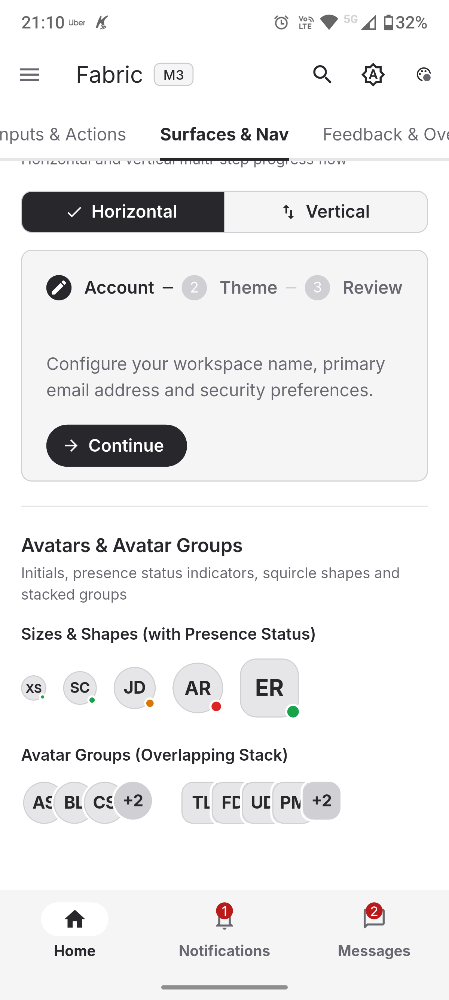
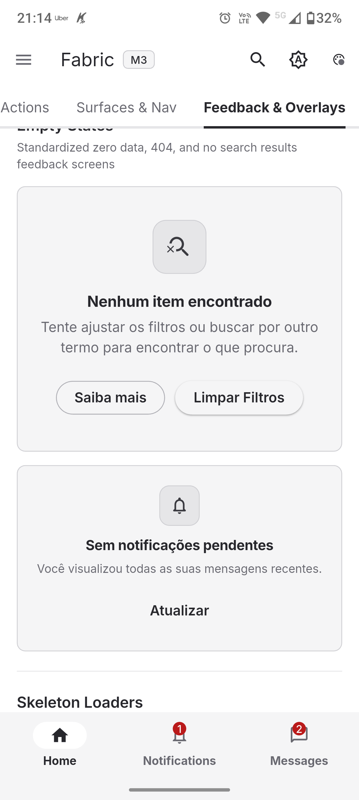

# Fabric

> A modern, opinionated Design System and Theme for Flutter based on Material 3, crafted with charcoal tones, subtle 1px perimeter borders, and refined Inter typography.

[](https://github.com/carllosnc/fabric/actions/workflows/ci.yml)


---

## 💡 Architecture & Philosophy

Fabric follows two core design rules:

1. **Theme-First**: Whenever Flutter exposes a `*ThemeData` (e.g. `CardThemeData`, `InputDecorationTheme`, `ElevatedButtonThemeData`), we style it directly in the theme layer. You use standard Flutter widgets (`Card`, `TextField`, `ElevatedButton`, `Dialog`, `Chip`, `Slider`), and they automatically look like Fabric.
2. **Dedicated Components**: When a widget cannot be styled via Flutter's `ThemeData` (because Flutter lacks theme support, has hardcoded internal layouts, or lacks the widget entirely), Fabric exports a first-class, token-aware component (`Fabric*`).

---

## 📦 Installation

Add Fabric to your `pubspec.yaml`:

```yaml
dependencies:
  fabric:
    git:
      url: https://github.com/carllosnc/fabric.git
```

---

## 🚀 Quick Start

### 1. Declarative `FabricTheme` (Recommended)

```dart
import 'package:fabric/fabric.dart';
import 'package:flutter/material.dart';

void main() {
  runApp(const MyApp());
}

class MyApp extends StatelessWidget {
  const MyApp({super.key});

  @override
  Widget build(BuildContext context) {
    const fabricTheme = FabricTheme(
      color: fabricGrey,
      fontFamily: 'Inter',
    );

    return MaterialApp(
      title: 'Fabric App',
      theme: fabricTheme.lightTheme,
      darkTheme: fabricTheme.darkTheme,
      themeMode: ThemeMode.system,
      home: const MyHomePage(),
    );
  }
}
```

Or instantiate directly via static factories:

```dart
MaterialApp(
  theme: FabricTheme.light(color: fabricBlue, fontFamily: 'Inter'),
  darkTheme: FabricTheme.dark(color: fabricBlue, fontFamily: 'Inter'),
);
```

### 2. Accessing Design Tokens & Active Swatch

Fabric includes a built-in `ThemeExtension` accessible anywhere via `BuildContext`:

```dart
// Access semantic status colors and surface tokens
final tokens = context.fabricTokens;
tokens.borderColor;       // Subtle 1px perimeter border (shade200 light / shade700 dark)
tokens.surfaceElevated;   // Soft elevated card/container surface (shade50 light / shade800 dark)
tokens.mutedForeground;   // Refined secondary text color (shade500 light / shade400 dark)
tokens.successColor;      // Semantic green
tokens.warningColor;      // Semantic amber
tokens.infoColor;         // Semantic blue

// Access the active palette swatch
final swatch = context.fabricSwatch;
Container(color: swatch.shade100);
```

---

## 🧩 Dedicated Fabric Components

Fabric exports high-level components for UI patterns that Flutter's `ThemeData` cannot customize:

### 1. `FabricStepper`
Flutter's native `Stepper` has no `StepperThemeData` and has hardcoded circle colors and action layouts. `FabricStepper` solves this with full token support, automatic step state calculation, and horizontal/vertical responsive layouts.

```dart
FabricStepper(
  currentStep: _currentStep,
  type: StepperType.horizontal,
  onStepContinue: () => setState(() => _currentStep++),
  onStepCancel: () => setState(() => _currentStep--),
  steps: const [
    FabricStep(
      title: Text('Account'),
      subtitle: Text('Details'),
      content: Text('Enter your email and credentials'),
    ),
    FabricStep(
      title: Text('Profile'),
      content: Text('Setup your profile picture'),
    ),
  ],
)
```

### 2. `FabricBanner`
Flutter's `MaterialBanner` only supports full-width layouts with a fixed bottom divider. `FabricBanner` provides a modern card notification callout with a 100% perimeter 1px border and semantic variants.

```dart
FabricBanner(
  variant: FabricBannerVariant.warning,
  title: 'Backup required',
  content: 'You haven\'t backed up your account data in 30 days.',
  actions: [
    TextButton(onPressed: () {}, child: const Text('Dismiss')),
    FilledButton(onPressed: () {}, child: const Text('Backup Now')),
  ],
)
```

### 3. `FabricBadge` (Status Tags & Pills)
Flutter's `Badge` is only an overlay on top of icons. `FabricBadge` provides standalone inline status tags with dot indicators, dismiss buttons, and multiple styles.

```dart
// Subtle with status dot
FabricBadge(
  label: 'Active',
  variant: FabricBadgeVariant.success,
  style: FabricBadgeStyle.subtle,
  showDot: true,
)

// Removable Tag
FabricBadge(
  label: 'Marketing',
  variant: FabricBadgeVariant.neutral,
  onDeleted: () => print('Tag removed'),
)
```

### 4. `FabricAvatar` & `FabricAvatarGroup`
Standardized avatars with automatic initials computation, squircle or circular shapes, and presence status indicators with cutout borders.

```dart
// Single Avatar with presence indicator
FabricAvatar(
  name: 'Carlos Santos',
  size: FabricAvatarSize.lg,
  status: FabricAvatarStatus.online,
  shape: FabricAvatarShape.rounded,
)

// Overlapping Avatar Group with '+N' overflow
FabricAvatarGroup(
  max: 3,
  avatars: const [
    FabricAvatar(name: 'Ana Silva'),
    FabricAvatar(name: 'Bruno Lima'),
    FabricAvatar(name: 'Carlos Dias'),
    FabricAvatar(name: 'Diana Prince'),
  ],
  onOverflowTap: () => print('View all members'),
)
```

### 5. `FabricEmptyState`
Clean, responsive zero-state presentations for empty lists, 404s, and no-search-results screens.

```dart
FabricEmptyState(
  iconData: Icons.folder_open_rounded,
  title: 'No projects yet',
  description: 'Create your first project to get started collaborating.',
  action: ElevatedButton(
    onPressed: () {},
    child: const Text('New Project'),
  ),
)
```

### 6. `FabricSkeleton`
GPU-efficient shimmer loading placeholders that adapt seamlessly between light and dark themes.

```dart
// Circular avatar placeholder
FabricSkeleton.circular(size: 48)

// Multi-line text placeholder
FabricSkeleton.text(lines: 3)

// Card container placeholder
FabricSkeleton.card(height: 120)
```

---

## 🎨 46+ Native M3 Widgets Themed by Fabric

All standard Flutter widgets below are styled centrally through `FabricTheme` with zero wrappers needed:

| Category | Themed Flutter Widgets |
| :--- | :--- |
| **Buttons & Actions** | `ElevatedButton`, `FilledButton`, `FilledButton.tonal`, `OutlinedButton`, `TextButton`, `IconButton`, `FloatingActionButton`, `SegmentedButton`, `ToggleButtons` |
| **Inputs & Forms** | `TextField`, `TextFormField`, `InputDecoration`, `DropdownMenu`, `SearchBar`, `SearchAnchor`, `SearchView`, `Checkbox`, `Radio`, `Switch`, `Slider`, `RangeSlider` |
| **Surfaces & Cards** | `Card`, `BottomSheet`, `ExpansionTile`, `ListTile`, `DataTable`, `PaginatedDataTable`, `Divider`, `CarouselView` |
| **Navigation** | `AppBar`, `SliverAppBar`, `NavigationBar`, `BottomNavigationBar`, `NavigationRail`, `Drawer`, `NavigationDrawer`, `MenuBar`, `MenuAnchor`, `TabBar` |
| **Feedback & Overlays** | `AlertDialog`, `Dialog`, `SnackBar`, `LinearProgressIndicator`, `CircularProgressIndicator`, `Tooltip`, `DatePicker`, `TimePicker` |
| **Typography** | Full Material 3 `TextTheme` tuned for `Inter` with progressive negative letter-spacing and proportional line heights |

---

## 🌈 Fabric Color Swatches

Fabric includes 8 hand-tuned, balanced color swatches with 11 shade stops (`50` to `950`):

- `fabricGrey` (Default modern charcoal)
- `fabricBlue`
- `fabricRed`
- `fabricGreen`
- `fabricPurple`
- `fabricTeal`
- `fabricOrange`
- `fabricPink`

### Creating a Custom Swatch

```dart
const FabricSwatch customBrand = FabricSwatch(
  0xFF0F172A,
  <int, Color>{
    50: Color(0xFFF8FAFC),
    100: Color(0xFFF1F5F9),
    200: Color(0xFFE2E8F0),
    300: Color(0xFFCBD5E1),
    400: Color(0xFF94A3B8),
    500: Color(0xFF64748B),
    600: Color(0xFF475569),
    700: Color(0xFF334155),
    800: Color(0xFF1E293B),
    900: Color(0xFF0F172A),
    950: Color(0xFF020617),
  },
);
```

---

## 📸 Showcase & Screenshots

| Tokens & Swatches (Light) | Tokens & Swatches (Dark) | Buttons & Segmented |
| :---: | :---: | :---: |
|  |  |  |

| Inputs, Search & Dropdown | Status Badges & Chips | Cards & Carousel |
| :---: | :---: | :---: |
|  |  |  |

| Navigation & Menus | Stepper & Avatars | Empty States & Skeletons |
| :---: | :---: | :---: |
|  |  |  |

Run the interactive showcase app inside `example/`:

```bash
cd example
flutter run
```

---

## 📄 License

MIT © [Carlos Costa](https://github.com/carllosnc)
